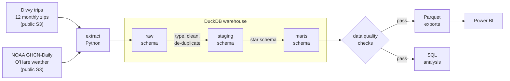
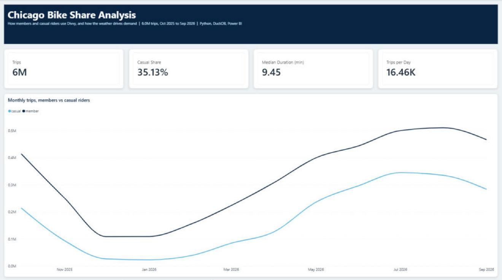

# Chicago Bike Share Pipeline

An end-to-end batch data pipeline that downloads a year of Chicago bike share trips
(about 6.2 million rows) and daily weather, cleans and models them in a DuckDB
warehouse, checks the result with automated data quality tests, and serves a star
schema to SQL analysis and a Power BI report.




## The business question

Divvy, Chicago's bike share, earns more from annual members than from casual riders.
This project asks: **how do members and casual riders differ, when and where do they
ride, and how much does the weather drive demand?** It also looks at an operations
question: which stations keep running out of bikes.

## Key findings

From twelve months of trips, October 2025 to September 2026. Every number comes from a
query in [`analysis/`](analysis) and can be regenerated with `bikeshare report`
(full results in [docs/analysis_results.md](docs/analysis_results.md)).

- **Casual riders take 35% of trips but ride longer.** Their median ride is 11.1
  minutes against 8.7 for members, and they are three times as likely to bring the bike
  back to where they started (4.9% vs 1.5%), a sign of leisure riding.
- **Demand is very seasonal, and casual riders are the swing.** July and August have
  more than six times January's trips. The casual share rises from 18% in January to 41%
  in July.
- **Temperature is the strongest driver.** Daily trips correlate at 0.87 with the day's
  maximum temperature. A wet day (1 mm+ of rain) cuts trips by 20–35% at most
  temperatures.
- **Campaign targets.** The stations with the most casual riders are all on the
  lakefront and museum campus (Navy Pier, Shedd Aquarium, Millennium Park), where 60–80%
  of departures are casual. That is where a membership offer would reach the most people.
- **Rebalancing.** The Field Museum station loses about 6.5 bikes a day on net, while
  Franklin St & Monroe St in the Loop gains about 7, so those are the first stations an
  operations team would restock or empty.

## Tech stack

| Layer | Tool | Why |
| --- | --- | --- |
| Extract | Python standard library (`urllib`, `zipfile`, `gzip`) | No heavy dependencies; streaming keeps memory flat. |
| Warehouse | [DuckDB](https://duckdb.org) | A real SQL database in one file: no server to run, fast on millions of rows, and anyone can clone and run the project. |
| Transform | SQL files run in order by Python | Plain SQL that an analyst can read, organised in raw, staging and marts layers. |
| Quality | SQL assertion queries | A failing check stops the run before anything is exported. |
| Testing | pytest, with fixture data | The whole pipeline runs in CI on a handful of hand-written rows, offline. |
| Lint | ruff | Consistent style, enforced in CI. |
| CI | GitHub Actions | Lint and tests on every push. |
| BI | Power BI | Reads the star schema from Parquet or straight from DuckDB over ODBC. |

## Quick start

Needs Python 3.10 or later and about 2 GB of free disk space.

```bash
git clone https://github.com/JoeKnowsData/chicago-bike-share-pipeline.git
cd chicago-bike-share-pipeline
python -m venv .venv
source .venv/bin/activate          # Windows: .venv\Scripts\activate
pip install -e ".[dev]"

bikeshare run                      # download, load, transform, check, export
bikeshare report                   # run the analysis queries into docs/analysis_results.md
pytest                             # tests (no downloads needed)
```

A full run takes a few minutes, most of it downloading. Re-runs skip files that are
already on disk.

Other commands:

```bash
bikeshare run --start 2026-06 --end 2026-08   # a different date range
bikeshare run --skip-extract                  # rebuild from files already downloaded
bikeshare transform                           # run any single step: extract, load, transform, check, export
bikeshare export --format csv                 # CSV instead of Parquet
```

To query the warehouse yourself, open it with the DuckDB CLI (`duckdb data/warehouse/bikeshare.duckdb`)
or any SQL client that supports DuckDB, such as DBeaver.

## How the pipeline works

### 1. Extract ([`extract.py`](src/bikeshare/extract.py))

- Downloads one zip per month from Divvy's public S3 bucket and pulls out the CSV.
- Streams NOAA's worldwide daily weather file for each year (about 170 MB compressed)
  and keeps only the O'Hare airport rows, so only a few hundred KB lands on disk.
- Idempotent: files already downloaded are skipped, and downloads go to a `.part` file
  first, so an interrupted run never leaves a half-written file behind.

### 2. Load ([`load.py`](src/bikeshare/load.py))

Copies every CSV into the `raw` schema **as text**, with the source file and load time on
each row. Nothing is typed or cleaned yet, so the raw layer is a faithful copy that can be
re-processed if a cleaning rule changes.

### 3. Transform ([`sql/`](sql))

| Layer | Model | What it does |
| --- | --- | --- |
| staging | [`trips`](sql/staging/01_trips.sql) | Types every column, cleans station names, removes duplicates and flags bad rows with a `reject_reason`. |
| staging | [`weather_daily`](sql/staging/02_weather.sql) | Pivots NOAA's one-row-per-measurement format to one row per day and converts units. |
| marts | [`dim_date`](sql/marts/01_dim_date.sql) | Calendar with each day's weather attached. |
| marts | [`dim_station`](sql/marts/02_dim_station.sql) | One row per station, with a `DOCKLESS` row for e-bikes left away from a dock. |
| marts | [`fct_trips`](sql/marts/03_fct_trips.sql) | One row per valid trip, with duration and distance. |
| marts | [`daily_summary`](sql/marts/04_daily_summary.sql) | Pre-aggregated daily totals for light dashboards. |
| marts | [`data_quality_summary`](sql/marts/05_data_quality_summary.sql) | What happened to every raw row. |

Column definitions are in the [data dictionary](docs/data_dictionary.md).

### 4. Check ([`sql/checks/`](sql/checks))

Each check is a query that returns the rows breaking a rule, so an empty result is a pass.
Checks cover unique keys, valid durations, accepted values, no orphan station or date keys,
row counts that reconcile from raw to marts, and a guard that stops the run if more than
10% of rows are rejected, which usually means the source file changed format.

### 5. Export ([`export.py`](src/bikeshare/export.py))

Writes the mart tables to `data/exports/*.parquet` for Power BI.

## Data cleaning

Real-world problems found in the source data, and how each is handled:

| Problem found | Rows | Handling |
| --- | ---: | --- |
| Rides under 60 seconds (false starts, re-docking) | 158,567 | Rejected, following Divvy's own guidance |
| Rides over 24 hours (lost, stolen or not docked) | 5,304 | Rejected |
| No end location recorded | 308 | Rejected |
| Rides that started in a month that wasn't loaded | 71 | Rejected (rides from the last day of September 2025 inside the October file) |
| Trips to or from test, warehouse and staff stations | 39 | Rejected |
| The same ride in two monthly files | 35 | Kept once |
| End time before start time | 29 | Rejected |
| Station names with stray spaces, a trailing `*`, or an `[Archived]` prefix | thousands | Cleaned (`Morgan St & Lake St*` → `Morgan St & Lake St`) |
| One station id with several names over the year | 55 ids | Most recent name kept |
| E-bike trips that start or end away from a station | 33% of trips | Kept, mapped to a `DOCKLESS` station |
| The January 2026 zip contains a file named `202501-…` | 1 file | File renamed from the month requested, not the name inside the zip |
| NOAA readings that failed NOAA's quality checks | | Ignored |

In total 97.3% of the 6.17 million raw rows reach `fct_trips`, and the
`data_quality_summary` table accounts for every row that doesn't.

## Project structure

```
├── src/bikeshare/        Python: extract, load, transform runner, checks, export, CLI
├── sql/
│   ├── staging/          cleaning models
│   ├── marts/            star schema
│   └── checks/           data quality assertions
├── analysis/             business questions answered in SQL
├── tests/                pytest suite with hand-written fixture data
├── docs/                 data dictionary, Power BI guide, analysis results
└── .github/workflows/    CI
```

## Power BI

The report is built on the `marts` star schema. [docs/powerbi.md](docs/powerbi.md) covers
connecting (Parquet or DuckDB ODBC), the relationships, starter DAX measures and suggested
pages.

<!-- Add screenshots of the report here, e.g.  -->

## Design decisions

- **DuckDB instead of a server database.** It runs the same SQL a warehouse would and
  handles 6 million rows in seconds on a laptop, and a reviewer can clone and run the
  project with no setup. Moving to Postgres, Snowflake or BigQuery would mean changing
  the connection and a handful of DuckDB-specific functions.
- **Raw, staging and marts layers.** Raw is untouched, staging holds the cleaning rules
  in one place, and marts are shaped for BI. A cleaning bug can be fixed and rebuilt
  without downloading anything again.
- **Reject, don't delete.** Bad rows stay in staging with a reason, so the data quality
  summary can account for every row and anyone can see what was removed and why.
- **Tests on fixtures, not on the live download.** The test data has one row for each
  problem the pipeline handles, so a test fails for a clear reason and CI never depends
  on an outside website.

## What I would add next

- **Orchestration:** schedule a monthly run with Airflow or Dagster, loading only the new
  month (an incremental load) instead of rebuilding the year.
- **Cloud:** land the raw files in S3 and run the warehouse in Snowflake, BigQuery or
  MotherDuck.
- **dbt:** port the SQL models and checks to dbt for lineage graphs and documentation.
- **Docker:** package the pipeline in a container so it runs the same everywhere.

## Data sources and licences

- **Trips:** [Divvy system data](https://divvybikes.com/system-data), provided by Lyft Bikes
  and Scooters, LLC under the [Divvy Data License Agreement](https://divvybikes.com/data-license-agreement).
- **Weather:** [NOAA GHCN-Daily](https://www.ncei.noaa.gov/products/land-based-station/global-historical-climatology-network-daily),
  station USW00094846 (Chicago O'Hare), via the [NOAA Open Data Dissemination](https://registry.opendata.aws/noaa-ghcn/)
  bucket on AWS. Public domain.

The data is downloaded at run time and is not stored in this repository. The code is
MIT licensed.
